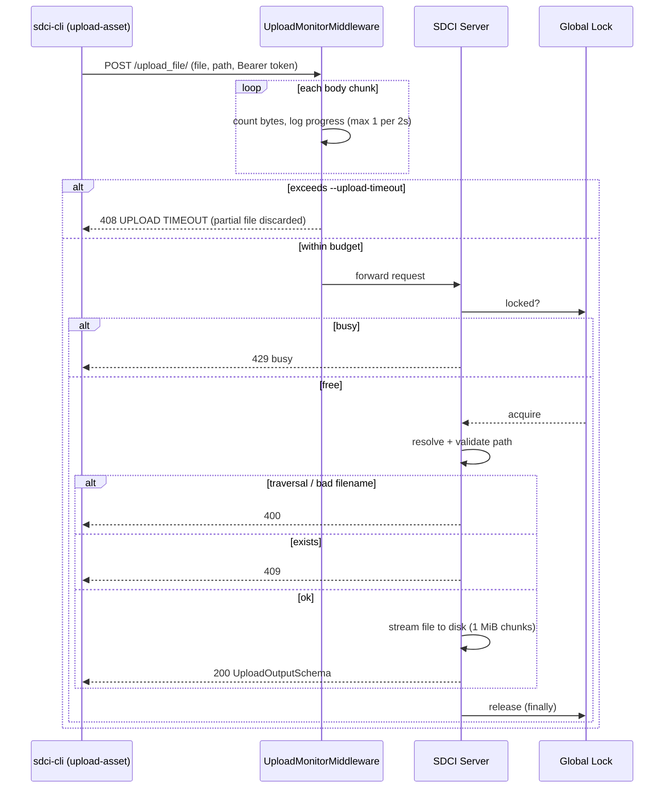

# File Upload

SDCI can push a single file (asset) to the server before or instead of running a
task. The file is stored under the server's upload directory, inside a
caller-specified relative directory (created recursively), keeping its original
filename.

## Server configuration

The upload directory is set with `--uploads-dir` (or the `UPLOADS_DIR` env var —
the legacy `UPLOAD_DIR` is still honored as a fallback — default `./uploads`). It
is created at startup if missing. `--upload-timeout` (env `UPLOAD_TIMEOUT`,
default `1800` — 30 minutes) caps how long a single upload may take.

```bash
sdci-server serve --uploads-dir ./uploads --upload-timeout 3600 \
  --server-token YOUR_TOKEN --tasks-dir ./tasks
```

## Endpoint

`POST /upload_file/` — `multipart/form-data`, Bearer token required.

| Field  | Type         | Meaning                                        |
|--------|--------------|------------------------------------------------|
| `file` | `UploadFile` | The file payload.                              |
| `path` | form `str`   | Relative destination directory (`REMOTE_PATH`).|

Response (`200`):

```json
{ "path": "releases/v1/app.zip", "size": 1234, "status": "UPLOADED" }
```

| Status | Meaning                                  |
|--------|------------------------------------------|
| 200    | Upload succeeded                         |
| 400    | Path traversal / invalid destination     |
| 401    | Bad/missing token                        |
| 408    | Upload exceeded `--upload-timeout`       |
| 409    | Destination file already exists          |
| 429    | Server busy (a task or upload is running)|

The endpoint shares the global lock with task execution, so the server runs
**either one task OR one upload at a time** and never overwrites an existing file.

## Client

```bash
sdci-cli upload-asset [--token TOKEN] [--timeout SECONDS] SERVER LOCAL_FILE REMOTE_PATH
```

Example (lands at `<uploads-dir>/releases/v1/app.zip` on the server):

```bash
sdci-cli upload-asset --token HAPPY123 --timeout 3600 http://localhost:8842 ./app.zip releases/v1
```

The client validates that `LOCAL_FILE` exists, streams it with a progress bar, and
exits non-zero on any failure. Token resolution is identical to `run`:
`--token` → `SDCI_TOKEN` env var → keyring.

## Timeouts

The two sides guard different things — set both when moving large artifacts over
a slow link.

| Side   | Knob                              | Default | Means                                                        |
|--------|-----------------------------------|---------|--------------------------------------------------------------|
| Client | `--timeout`, env `CLIENT_REQUEST_TIMEOUT` | 1800 s | Socket inactivity: how long the client waits on a stalled connection, **not** a total budget. |
| Server | `--upload-timeout`, env `UPLOAD_TIMEOUT`  | 1800 s | Wall-clock budget for the whole request (receiving the body **and** writing it to disk). |

Precedence is the same on both sides: flag → env var → default. Note that
`CLIENT_REQUEST_TIMEOUT` covers every client request (including `run`), while
`--timeout` overrides it for a single `upload-asset` call. Task execution has its
own, separate budget (`TASK_RUN_TIMEOUT`, default 600 s).

When the server budget is exceeded, the request is cancelled, the partially
written file is deleted, the global lock is released, and the client gets:

```json
{ "detail": "UPLOAD TIMEOUT - exceeded 1800s" }
```

## Transfer progress

The server logs how much data has arrived, at most once every two seconds, so a
long transfer is visible while it happens:

```
[INFO] sdci.server_runner: UPLOAD PROGRESS - 10.0.0.4 - 10.1 MiB / 30.0 MiB (33%) - 5.0 MiB/s
[INFO] sdci.server_runner: UPLOAD PROGRESS - 10.0.0.4 - 20.1 MiB / 30.0 MiB (66%) - 5.0 MiB/s
[INFO] sdci.server_runner: UPLOAD RECEIVED - 10.0.0.4 - 30.0 MiB in 6.0s - 5.0 MiB/s
[INFO] sdci.server: SDCI - UPLOAD FILE - releases/v1/app.zip
[INFO] sdci.server_runner: UPLOADED FILE: /uploads/releases/v1/app.zip (31457280 bytes)
```

Totals and percentages come from the request's `Content-Length`; without that
header only the received amount and rate are logged. Uploads shorter than the
two-second interval log nothing extra.

Progress lines are labelled with the **client address**, not the destination
path: while the body is still arriving, the multipart payload carrying the
filename has not been parsed yet.

> **Why a middleware?** FastAPI spools the entire multipart body to a temporary
> file *before* the endpoint function runs, so counting bytes (or timing out)
> inside the endpoint would only measure the local temp→destination copy — 18 ms
> for a 30 MiB file that spent 6 s on the wire. `UploadMonitorMiddleware`
> therefore sits at the ASGI layer, below the body parsing.

## Flow


